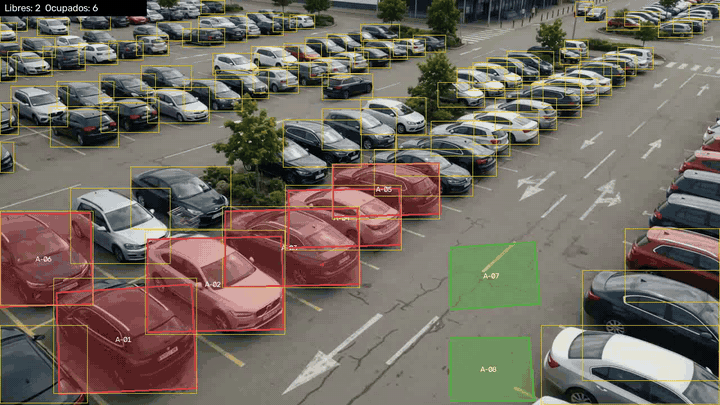
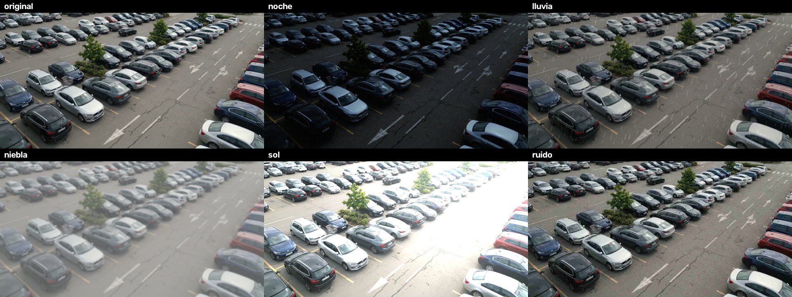

# Sistema Inteligente de Estacionamiento — IEST Anáhuac

**Versión 1.0 (versión funcional, lista para pruebas).** Detecta en tiempo real qué cajones del
estacionamiento están libres u ocupados a partir de las cámaras de videovigilancia (RTSP), identifica el
colgante del vehículo y expone la información mediante una API y una app móvil.

```
Cámaras ──RTSP/LAN──▶ vision/ (YOLOv8 + OpenCV) ──▶ api/ (FastAPI) ──▶ PostgreSQL
                                                         ▲
                                                  mobile/ (React Native)
```

| Carpeta | Contenido | Tarea del cronograma |
|---|---|---|
| `mobile/` | App móvil React Native (Expo) | 3.1 |
| `api/`, `docker-compose.yml`, `scripts/` | Entorno, servidor y API | 3.2 |
| `db/`, `api/app/models.py` | Modelo y esquema de base de datos | 3.3 |
| `vision/` | Servidor de procesamiento de imagen | 3.4 |
| `api/app/routers/admin.py`, `watchdog.py`, `mobile/src/services/` | Integración de componentes | 3.5 |
| `tests/e2e/`, [`docs/PRUEBAS_INTEGRACION.md`](docs/PRUEBAS_INTEGRACION.md) | Pruebas end-to-end | 3.6 |
| [`CHANGELOG.md`](CHANGELOG.md) | Alcance y límites de la v1.0 | 3.7 |

## Requisitos

- Python 3.10+ (probado en 3.12)
- Node.js 20+ (solo para la app móvil)
- Docker (para PostgreSQL y la API; opcional para desarrollo, ver abajo)
- GPU NVIDIA opcional: acelera YOLO, pero no es necesaria con `yolov8n`

## Instalación

```bash
python -m venv .venv
.venv\Scripts\activate            # Linux/Mac: source .venv/bin/activate
pip install -r api/requirements.txt -r vision/requirements.txt
python scripts/check_env.py       # verifica OpenCV, YOLO, torch, docker, node...
cp .env.example .env              # Windows: copy .env.example .env
```

Edita `.env` y **cambia** `JWT_SECRET` e `INGEST_API_KEY` (y la contraseña de PostgreSQL). Mientras tengan
el valor de ejemplo (`cambia_...`) la API rechaza el login y la ingesta a propósito. Genera valores con:

```bash
python -c "import secrets; print(secrets.token_urlsafe(48))"
```

## Ejecutar el sistema

### Opción A: con Docker (como en el piloto)

```bash
docker compose up -d db api
docker compose run --rm -e SEED_ADMIN_PASSWORD='una-clave-segura' api python -m app.seed   # una sola vez
```

API y documentación interactiva en `http://localhost:8000/docs`.

### Opción B: sin Docker (desarrollo y demostración)

En `.env` pon `DATABASE_URL=sqlite:///./dev.db` y luego:

```bash
cd api
SEED_ADMIN_PASSWORD='una-clave-segura' SEED_DEMO_PASSWORD='otra-clave-segura' python -m app.seed --demo
python -m uvicorn app.main:app --host 0.0.0.0 --port 8000
```

(En PowerShell usa `$env:SEED_ADMIN_PASSWORD='...'` antes de cada comando.) El seed crea las zonas A, B y C
(48 cajones), las cámaras `CAM-01` a `CAM-03`, el administrador `admin@iest.edu.mx` y, con `--demo`, el
usuario `demo@iest.edu.mx` con un vehículo y el colgante `IEST-004512`. Si no das contraseña, se genera una
aleatoria y se imprime una sola vez.

### Servidor de visión

Con cámaras reales, sigue [`vision/README.md`](vision/README.md) (dibujar los cajones, `--once`, `--dry-run`).

**Sin cámaras (demostración):** el simulador publica entradas y salidas aleatorias a la API:

```bash
python scripts/simulate_cameras.py --api http://localhost:8000 --interval 2
```

### App móvil

```bash
cd mobile
cp .env.example .env              # EXPO_PUBLIC_API_URL = IP de tu PC en la red (no localhost) si usas un teléfono
npm install
npx expo start                    # escanea el QR con Expo Go
```

Con `EXPO_PUBLIC_USE_MOCK=true` la app funciona con datos de ejemplo, sin API. Con `false` (valor por defecto)
usa la API real; entra con `demo@iest.edu.mx` o `admin@iest.edu.mx` (el administrador ve además la pestaña
Admin con eventos y alertas de cámaras). La disponibilidad se actualiza sola cada 15 s.

## API

Documentación interactiva en `/docs`.

| Endpoint | Quién | Para qué |
|---|---|---|
| `POST /auth/login`, `GET /auth/me` | todos | Sesión con JWT |
| `GET /espacios`, `/vehiculos/mios`, `/notificaciones` | usuarios | Datos de la app |
| `GET /eventos`, `/camaras` | admin | Historial y alertas de cámaras |
| `GET/POST/PATCH /usuarios`, `GET/POST /vehiculos`, `GET/POST/PATCH /colgantes` | admin | Registro y administración |
| `PATCH /espacios/{id}`, `POST /notificaciones` | admin | Asignar cajón, corregir estado manualmente, enviar avisos |
| `POST /ingest/ocupacion`, `/ingest/camara-estado` | servidor de visión (`X-API-Key`) | Publica ocupación y estado de cámaras |

La API genera sola los avisos "zona casi llena / llena" y marca como desconectada a toda cámara que lleve más
de 3 minutos sin enviar datos (`CAMERA_TIMEOUT_S`).

## Pruebas

```bash
python scripts/run_tests.py       # API, visión, end-to-end y tipos de la app
```

Resultados y alcance en [`docs/PRUEBAS_INTEGRACION.md`](docs/PRUEBAS_INTEGRACION.md); los registros, videos e imágenes
de esas corridas están en [`evidencias/`](evidencias). Como no hay acceso a las cámaras
reales, la validación se hace con video: ver [`docs/SIMULACION.md`](docs/SIMULACION.md).
Detalles del servidor de visión en [`vision/README.md`](vision/README.md) y de la base de datos en [`db/README.md`](db/README.md).

## Evidencias

Registros de pruebas, videos e imágenes de la simulación en [`evidencias/`](evidencias). Vista rápida (cajones sobre
un video generado con IA, verde = libre, rojo = ocupado) y detalle completo en
[`evidencias/README.md`](evidencias/README.md):





## Flujo de trabajo

- Una rama `main` estable; cada tarea del cronograma entra como un commit/PR `feat(X.Y): ...`.
- Los secretos van en `.env` (ignorado por git). Nunca se suben contraseñas ni modelos `.pt`.
- Los fotogramas de las cámaras se procesan en memoria y no se guardan, salvo el modo opcional
  de recolección de baja confianza para reentrenamiento (desactivado por defecto).
