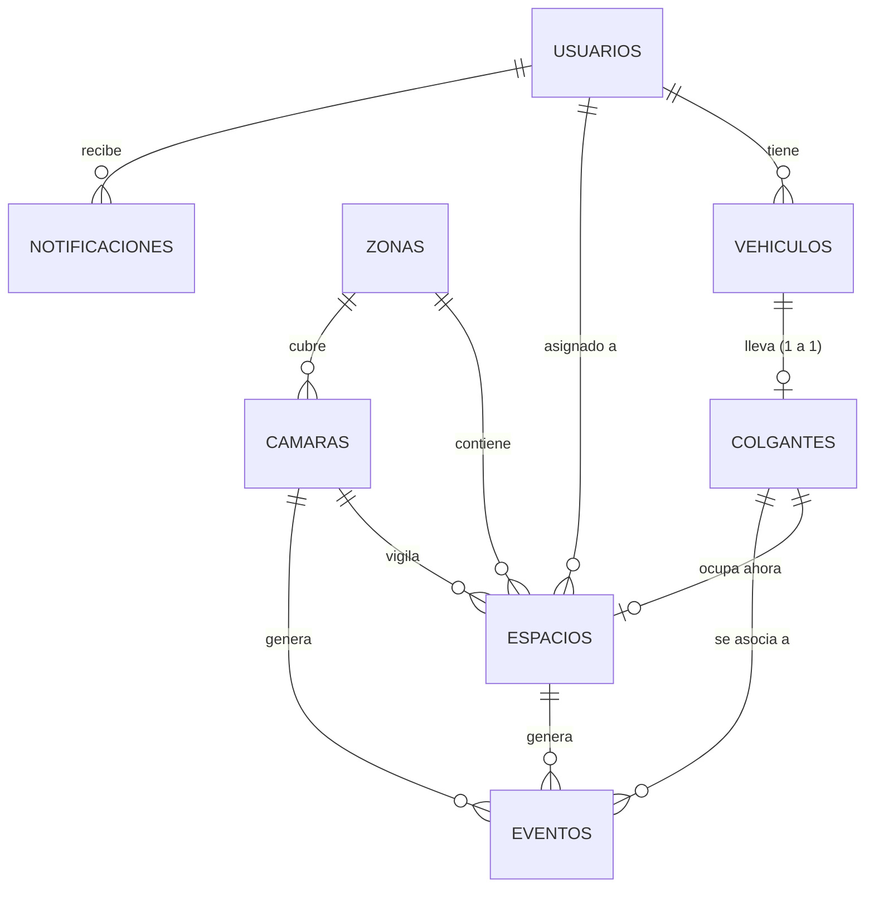

# Base de datos (tarea 3.3)

PostgreSQL 16 (el mismo modelo funciona en SQLite para pruebas). La fuente de verdad es
[`api/app/models.py`](../api/app/models.py); [`schema.sql`](schema.sql) se genera con
`python scripts/export_schema.py`.



| Tabla | Para qué sirve |
|---|---|
| `usuarios` | Estudiantes, docentes, directivos, administrativos, externos y admins. Contraseña solo como hash scrypt |
| `vehiculos` | Vehículos de cada usuario (la placa es opcional) |
| `colgantes` | Código leído por OCR + tipo; un colgante por vehículo |
| `zonas` / `camaras` | Zonas del estacionamiento y cámara RTSP que las cubre (estado y última señal) |
| `espacios` | Cajón: número, zona, tipo, estado actual, `monitoreado` (una cámara ya lo observó; si no, su "libre" es solo el valor inicial), `estado_desde` / `inicio_observado` (desde cuándo está así y si la cámara vio el cambio), `objeto` (qué lo obstruye), asignado y colgante que lo ocupa. Estados: libre, ocupado, **obstruido** (un objeto que no es vehículo), reservado y fuera de servicio |
| `eventos` | Historial de auditoría: entradas, salidas (con cuánto estuvo), obstrucciones y su retiro, cambios de ocupación, errores y cámaras caídas |
| `notificaciones` | Avisos para la app (`usuario_id` nulo = para todos) |

## Decisiones

- **Zona = isla.** El estacionamiento son 8 islas (A a H) de 40 cajones, 320 en total, una cámara por isla. En el modelo
  de datos la tabla se llama `zonas`; en la app y el panel se muestra como "Isla".
- **Colgante vs. placa:** el cronograma habla de placas, la arquitectura de colgantes. El modelo usa el
  colgante como identificador principal y deja la placa como dato opcional del vehículo.
- Las URL RTSP (con usuario y contraseña) **no** se guardan aquí, solo en la config del servidor de visión.
- No se almacenan imágenes en la BD.
- Enums guardados como texto con `CHECK`, para poder migrar de motor sin sorpresas.

## Cargar datos iniciales

```bash
cd api
SEED_ADMIN_PASSWORD='una-clave-segura' python -m app.seed --demo
```
