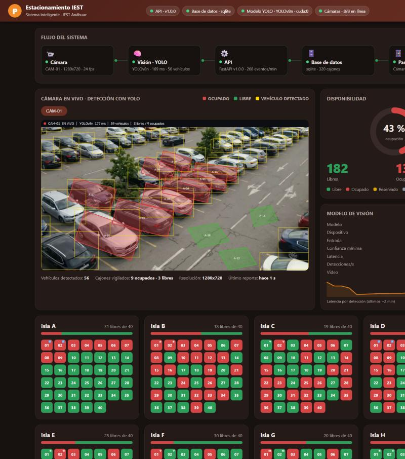

# Demostración del sistema

Un panel web que muestra el sistema funcionando de punta a punta: un video tratado como cámara fija, el modelo YOLO
detectando vehículos y cajones en vivo, y cómo esos datos viajan por la API y la base de datos hasta el mapa de
disponibilidad.



## Cómo levantarla

```bash
python scripts/iniciar_demo.py
```

Abre `http://localhost:8000/panel` y deja todo corriendo hasta que presiones Ctrl+C. La primera vez prepara lo que
falta: `.env` con claves aleatorias, base de datos con usuarios de demostración (sus claves quedan en
`credenciales_demo.txt`, que no se sube a git), el video estabilizado y el modelo `yolov8n.pt` (~6 MB, se descarga de
Ultralytics). Con GPU NVIDIA cada detección tarda unos 70 a 120 ms; en CPU será más lento.

Entra como `admin@iest.edu.mx` para ver todo (eventos y estado de las cámaras) o como `demo@iest.edu.mx` para ver la
vista de un usuario.

## Qué se ve

| Sección | Qué muestra | De dónde sale |
|---|---|---|
| Barra superior | Estado de la API, la base de datos, el modelo YOLO (modelo y GPU) y las cámaras | `GET /sistema/estado` |
| Flujo del sistema | Cámara → Visión (YOLO) → API → Base de datos → Panel/app, cada uno con su estado y sus cifras; las conexiones se animan cuando hay datos | Estado real, cada 2 s |
| Cámara en vivo | El video con los vehículos detectados (amarillo) y los cajones en rojo (ocupado) o verde (libre) | Servidor de visión, por MJPEG |
| Modelo de visión | Modelo, dispositivo, tamaño de entrada, confianza mínima, latencia, detecciones por segundo y su gráfica | El servidor de visión lo reporta a la API |
| Disponibilidad y mapa | Libres, ocupados y % de ocupación; las 8 islas con sus 40 cajones, que destellan cuando cambian | `GET /espacios` |
| Eventos, cámaras y avisos | Entradas y salidas en tiempo real, estado de cada cámara, avisos "zona casi llena" | `GET /eventos`, `/camaras`, `/notificaciones` |

## Cómo se conecta el modelo con el sistema

1. `demo_server` lee el video fotograma a fotograma, como lo haría una cámara fija.
2. Cada 0.5 s YOLOv8 detecta los vehículos y `occupancy.py` decide qué cajones están ocupados (con antirrebote).
3. Si algo cambia (o cada 10 s), publica la ocupación en la API (`POST /ingest/ocupacion`, con su clave).
4. Cada 2 s reporta cómo va el modelo (`POST /ingest/modelo`): latencia, FPS, vehículos.
5. La API guarda la ocupación y los eventos en la base de datos y los muestra al panel y a la app.
6. El video anotado se emite aparte (`http://localhost:8100/stream/CAM-01`) y el panel lo incrusta.

Es el mismo código de ocupación, antirrebote y publicación que usa el servidor de visión de producción
(`parking_vision.run`); lo que cambia es que aquí la fuente es un archivo de video y no una cámara RTSP.

## Qué es real y qué es demostrativo

- **Real:** el modelo YOLO, la decisión de ocupación, el envío a la API, la base de datos, los eventos y los avisos.
- **Demostrativo:**
  - El video está **generado con IA**: una toma aérea que se estabilizó para que parezca cámara fija, y no hay
    entradas ni salidas de vehículos en él. Los 12 cajones vigilados de la isla A están dibujados a ojo (9 con auto y 3 sobre
    asfalto vacío).
  - Las **islas B a H** las mueve un simulador aleatorio para que haya eventos en vivo; no vienen de ninguna cámara.
  - El estacionamiento son **8 islas de 40 cajones** (320 en total), una cámara por isla; solo la isla A tiene video.
  - No hay lectura de colgantes: los vehículos aparecen "sin colgante identificado".
- No sustituye la validación con cámaras reales del IEST (ver [`SIMULACION.md`](SIMULACION.md)).

El video emitido en el puerto 8100 no tiene autenticación; usa la demostración solo en tu red local.

## Si algo falla

- **El video dice "Sin señal":** el servidor de visión no está corriendo o tarda en cargar el modelo (unos 10 a 30 s).
  Si lo abriste desde otro equipo, agrega `?vision=http://IP_DEL_SERVIDOR:8100` a la dirección del panel.
- **Puerto ocupado:** usa `--puerto-api` o `--puerto-video`.
- **Otro video o cajones:** `scripts/preparar_demo.py` genera el video estabilizado y `demo/cameras_demo.json`; los
  cajones se redibujan con `parking_vision.tools.define_spaces`.
