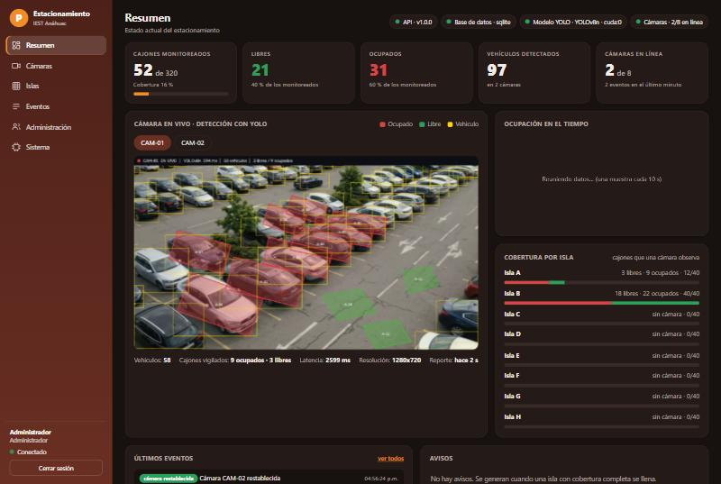
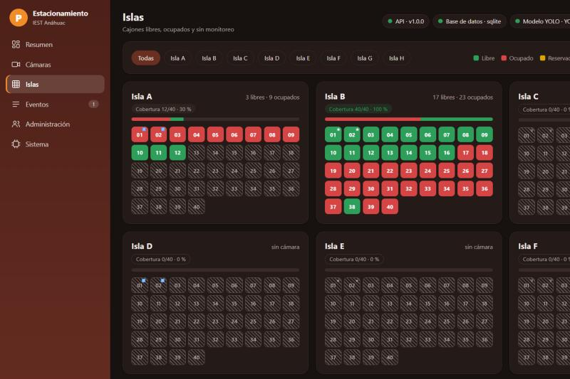

# Ejecución del sistema

El sistema funciona de punta a punta con lo que hay hoy: **videos tratados como cámaras fijas**. El modelo YOLO detecta
los vehículos, decide qué cajones están libres u ocupados, lo publica en la API y lo guarda en la base de datos; el
panel web y la app móvil lo consultan. Todo lo que muestran es lo que el modelo observa: no hay datos inventados.



## Cómo levantarlo

```bash
python scripts/iniciar_sistema.py
```

Abre `http://localhost:8000/panel` y deja todo corriendo hasta que presiones Ctrl+C. La primera vez prepara lo que
falta: `.env` con claves aleatorias, la base de datos con el usuario administrador (su clave queda en
`credenciales.txt`, que no se sube a git) y los modelos `yolov8n.pt` (~6 MB, de Ultralytics); `yolov8s.pt` se descarga aparte (ver `vision/README.md`). Con una
GPU NVIDIA cada detección tarda unos 70 a 120 ms; en CPU será más lenta.

Desde el panel (sección **Administración**) se registran usuarios, vehículos y colgantes. Con esos usuarios se entra a
la app móvil.

## Dejarlo corriendo en localhost (sin terminal abierta)

Para que el sitio quede funcionando en segundo plano, sin ventanas y sin que nadie lo inicie a mano, hay un servicio de Windows
(una tarea del usuario que arranca al **iniciar sesión**; no pide permisos de administrador):

| Qué quieres | Comando (en PowerShell, desde la carpeta del proyecto) |
|---|---|
| Instalarlo y arrancarlo (una sola vez) | `powershell -ExecutionPolicy Bypass -File scripts\servicio.ps1 instalar` |
| Ver si está corriendo | `... scripts\servicio.ps1 estado` |
| Detenerlo / volver a iniciarlo | `... scripts\servicio.ps1 detener` · `iniciar` · `reiniciar` |
| Quitarlo del todo | `... scripts\servicio.ps1 quitar` |

También se puede hacer doble clic en `scripts\servicio.bat` (sin argumento muestra el estado; ábrelo desde una terminal con
`scripts\servicio.bat instalar` para instalarlo). Después de instalarlo, el panel está siempre en `http://localhost:8000/panel`
cuando tu sesión de Windows está abierta; si el sistema se cae, se reinicia solo (hasta 5 veces). El registro queda en
`logs\sistema.log`. En este modo la API escucha **solo en 127.0.0.1**: no se puede abrir desde otros equipos (para la app en un
teléfono usa `python scripts/iniciar_sistema.py`, que sí escucha en la red local). No lo mezcles con `iniciar_sistema.py` a mano:
usan los mismos puertos (8000 y 8100). Para probarlo sin instalar nada: `python scripts/iniciar_sistema.py --oculto --host 127.0.0.1`
(se detiene con `servicio.ps1 detener` o terminando el PID de `logs\sistema.pid`).

## Qué cámaras hay

El estacionamiento son **391 cajones**: 8 filas (271 cajones; la fila 1 es la isla A, la 2 la B... la 8 la H) y 6 zonas en el perímetro (120),
según la distribución real (detalle en [`db/README.md`](../db/README.md)). **Las únicas cámaras que se usan son 3**, con grabaciones reales del
IEST (8 minutos, 6 fps, del 26/10/2026 a las 06:58). Los videos pesan decenas de MB y llevan personas y placas: están en `datasets/reales/`,
que Git ignora, y se llaman `real_a.mp4`, `real_b.mp4` y `real_c.mp4`. Sin ellos `iniciar_sistema.py` no arranca y avisa cuáles faltan. La
configuración (videos, parámetros y cajones de cada cámara) está en `camaras/camaras.json`.

| Cámara | Nombre | Video | Cajones vigilados |
|---|---|---|---|
| CAM-01 | Fila 1 y 2 | `real_a.mp4`, 2688×1512, ojo de pez | 40: fila 1 (`A-09` a `A-16` y `A-26` a `A-32`, dibujados con perspectiva; el resto queda fuera del encuadre), fila 2 (`B-01` a `B-17`, un cajón por coche, sin vacíos) y la esquina de motos (`MOT-01` a `MOT-08`) |
| CAM-02 | Estacionamiento | `real_b.mp4`, 1920×1080, vista general | 133: filas 5, 6 y 7 completas (`E`, `F`, `G`, con vacíos), fila 4 provisional (`D`, de los coches estacionados) y 18 de la lateral de la biblioteca (`BIB-01` a `BIB-18`) |
| CAM-03 | Entrada | `real_c.mp4`, 854×480, la pluma de la caseta | No vigila cajones: es para el flujo de entradas y salidas |

La fila 8 no tiene grabaciones y el resto del perímetro (caseta, gimnasio, entrada lateral, callejón) no está en cámara. Los cajones se
dibujan sobre cada video con las herramientas de `scripts/cajones_reales/`; sus polígonos están en `camaras/cajones/`.

### "Sin monitoreo" no es "libre"

Un cajón que ninguna cámara ha observado **no se muestra como libre**: aparece rayado como *sin monitoreo*, y no cuenta en
los libres ni en los ocupados. El panel y la app muestran la **cobertura** (cajones monitoreados sobre el total) por isla y
en general. Los avisos "isla casi llena" y "isla llena" solo se generan cuando la isla tiene cobertura completa.



## Libre, ocupado, obstruido

Cada cajón monitoreado está en uno de tres estados que decide la cámara: **libre** (verde), **ocupado** por un vehículo (rojo) u
**obstruido** (amarillo): sin vehículo pero con un objeto dentro (una persona parada, una maleta, una bicicleta...). Un cajón
obstruido no cuenta como libre. *Reservado* (azul) y *fuera de servicio* los fija un administrador. Detalles y límites
(los objetos que YOLO no conoce, como un cono, no se detectan) en [`vision/README.md`](../vision/README.md) y
[`SIMULACION.md`](SIMULACION.md).

Cada cajón dice también **cuánto lleva en su estado**: para un coche, cuánto tiempo lleva estacionado sin moverse. Cuando la
cámara no vio la llegada, se muestra como "al menos".

## Qué se ve en el panel

| Sección | Contenido |
|---|---|
| Resumen | Cajones monitoreados, libres, ocupados y obstruidos; los coches que llevan más tiempo estacionados; el seguimiento de coches (cuántos hay, cuáles están quietos o en movimiento y cuáles están quietos fuera de un cajón); vehículos detectados; video con las detecciones; gráfica de ocupación en el tiempo (se llena mientras corre); cobertura por isla; últimos eventos y avisos |
| Mapa | Plano esquemático del estacionamiento: las 8 islas al centro y las 6 zonas del perímetro alrededor, con cada cajón en su color en vivo; clic en un cajón para su detalle |
| Cámaras | Una tarjeta por cámara con su video en vivo (clic para ampliar), latencia, vehículos y estado; las islas sin cámara se marcan "sin video configurado" |
| Islas | Los 391 cajones por isla y zona del perímetro; clic en un cajón para ver su estado, su cámara y, a administradores, su historial y quién lo ocupa |
| Eventos | Entradas, salidas y alertas con filtros y búsqueda (solo administradores) |
| Administración | Registrar usuarios, vehículos y colgantes; listados |
| Sistema | Flujo cámara → modelo → API → base de datos → app, y el estado del modelo por cámara |

## Cómo se conecta el modelo con el sistema

1. `servidor` (`parking_vision.servidor`) lee cada video a su velocidad real, como lo haría una cámara fija.
2. Cada 0.5 s YOLOv8 detecta los vehículos y `occupancy.py` decide qué cajones están ocupados, con antirrebote temporal
   y **histéresis** (un cajón ya ocupado se conserva con una detección más débil, para que un auto parcialmente tapado no
   haga parpadear el estado).
3. Cuando algo cambia (o cada 10 s) publica la ocupación en la API (`POST /ingest/ocupacion`, con su clave).
4. La **primera** observación de un cajón fija su estado inicial: no genera evento. Solo los cambios posteriores son
   entradas o salidas. Lo mismo ocurre durante el **calentamiento** (unos 20 s tras arrancar y 10 s cada vez que un video en
   bucle se reinicia): un auto que estaba tapado y aparece, o el salto de la escena al reiniciar, se toman como estado
   inicial y no como entradas ni salidas.
5. Cada 2 s reporta cómo va el modelo (`POST /ingest/modelo`): latencia, detecciones por segundo, vehículos.
6. La API guarda ocupación y eventos en la base de datos y los sirve al panel y a la app. El video anotado se emite aparte
   (`http://localhost:8100/stream/CAM-01`).

Es el mismo código de ocupación y publicación que usa el servidor de visión de producción (`parking_vision.run`); aquí la
fuente es un archivo de video y no una cámara RTSP.

## Límites que hay que tener presentes

- Las cámaras son grabaciones de 8 minutos que se repiten en bucle, no una transmisión en vivo: los eventos de un ciclo se repiten en el siguiente.
- El video emitido se dibuja y comprime solo mientras alguien lo mira (panel abierto en Resumen o Cámaras); con nadie viendo, toda
  la capacidad queda para el modelo.
- No hay lectura de colgantes: los vehículos aparecen como "sin colgante identificado" hasta que exista un modelo entrenado.
- Los cajones se dibujaron a partir de los videos (ver `scripts/cajones_reales/`) y varios son provisionales; la precisión real del sistema
  solo se podrá medir con etiquetas propias (`docs/ETIQUETADO.md`).
- El video emitido en el puerto 8100 no tiene autenticación: úsalo solo en tu red local.

## Simulación opcional (no es operación real)

`python scripts/iniciar_sistema.py --con-simulacion` agrega un simulador que llena el resto de los cajones con **datos
inventados** (estancias y ocupación tomadas del perfil de un dataset sintético de Kaggle; ver
[`DATASET_KAGGLE.md`](DATASET_KAGGLE.md)) y crea 150 usuarios de muestra. Sirve para pruebas de carga o para ver el panel
lleno; no lo mezcles con una operación real.

## Si algo falla

- **El video dice "Sin señal":** el servidor de visión no está corriendo o tarda en cargar el modelo (10 a 30 s). Si abriste
  el panel desde otro equipo, agrega `?vision=http://IP_DEL_SERVIDOR:8100` a la dirección.
- **Puerto ocupado:** usa `--puerto-api` o `--puerto-video`.
- **Otro video o cajones:** `scripts/cajones/descubrir_cajones.py` propone cajones a partir de dónde se estacionan los autos, y
  `parking_vision.tools.define_spaces` permite dibujarlos a mano sobre las líneas del estacionamiento.
