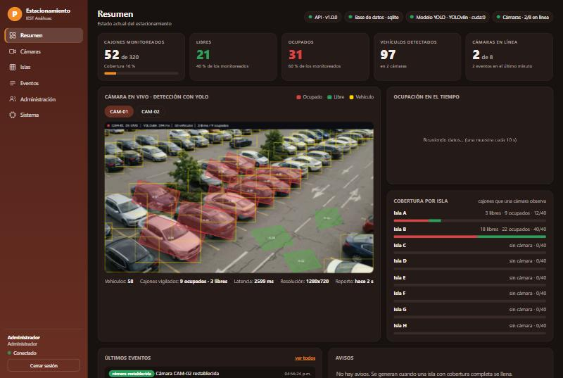
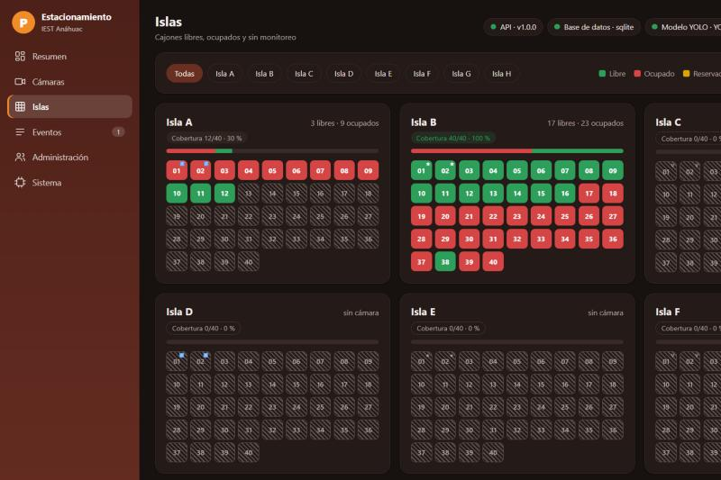

# Ejecución del sistema con videos como cámaras

El sistema funciona de punta a punta con lo que hay hoy: **videos tratados como cámaras fijas**. El modelo YOLO detecta
los vehículos, decide qué cajones están libres u ocupados, lo publica en la API y lo guarda en la base de datos; el
panel web y la app móvil lo consultan. Todo lo que muestran es lo que el modelo observa: no hay datos inventados.



## Cómo levantarlo

```bash
python scripts/iniciar_sistema.py
```

Abre `http://localhost:8000/panel` y deja todo corriendo hasta que presiones Ctrl+C. La primera vez prepara lo que
falta: `.env` con claves aleatorias, la base de datos con el usuario administrador (su clave queda en
`credenciales.txt`, que no se sube a git), el video de CAM-01 y el modelo `yolov8n.pt` (~6 MB, de Ultralytics). Con una
GPU NVIDIA cada detección tarda unos 70 a 120 ms; en CPU será más lenta.

Desde el panel (sección **Administración**) se registran usuarios, vehículos y colgantes. Con esos usuarios se entra a
la app móvil.

## Qué cámaras hay

El estacionamiento son **8 islas de 40 cajones** (320 en total), una cámara por isla. Hoy hay video para dos:

| Cámara | Isla | Video | Cajones vigilados |
|---|---|---|---|
| CAM-01 | A | Toma aérea **generada con IA**, estabilizada para que parezca fija | 12 de 40 (9 con auto y 3 sobre asfalto vacío) |
| CAM-02 | B | **Cámara de seguridad real** y fija | 40 de 40 (23 ocupados y 17 vacíos al inicio) |
| CAM-03 a CAM-08 | C a H | — | Ninguno |

El video de CAM-02 es de terceros y **no se incluye en el repositorio**: cópialo a `demo/camara2_cctv.mp4`. Sin él, CAM-02
no se activa y la isla B queda sin monitoreo. Los cajones de CAM-02 (`demo/cajones_cam02.json`) sí están en el repo.

### "Sin monitoreo" no es "libre"

Un cajón que ninguna cámara ha observado **no se muestra como libre**: aparece rayado como *sin monitoreo*, y no cuenta en
los libres ni en los ocupados. El panel y la app muestran la **cobertura** (cajones monitoreados sobre el total) por isla y
en general. Los avisos "isla casi llena" y "isla llena" solo se generan cuando la isla tiene cobertura completa.



## Qué se ve en el panel

| Sección | Contenido |
|---|---|
| Resumen | Cajones monitoreados, libres y ocupados; vehículos detectados; video con las detecciones; gráfica de ocupación en el tiempo (se llena mientras corre); cobertura por isla; últimos eventos y avisos |
| Cámaras | Una tarjeta por cámara con su video en vivo (clic para ampliar), latencia, vehículos y estado; las islas sin cámara se marcan "sin video configurado" |
| Islas | Los 320 cajones por isla; clic en un cajón para ver su estado, su cámara y, a administradores, su historial y quién lo ocupa |
| Eventos | Entradas, salidas y alertas con filtros y búsqueda (solo administradores) |
| Administración | Registrar usuarios, vehículos y colgantes; listados |
| Sistema | Flujo cámara → modelo → API → base de datos → app, y el estado del modelo por cámara |

## Cómo se conecta el modelo con el sistema

1. `demo_server` lee cada video a su velocidad real, como lo haría una cámara fija.
2. Cada 0.5 s YOLOv8 detecta los vehículos y `occupancy.py` decide qué cajones están ocupados, con antirrebote temporal
   y **histéresis** (un cajón ya ocupado se conserva con una detección más débil, para que un auto parcialmente tapado no
   haga parpadear el estado).
3. Cuando algo cambia (o cada 10 s) publica la ocupación en la API (`POST /ingest/ocupacion`, con su clave).
4. La **primera** observación de un cajón fija su estado inicial: no genera evento. Solo los cambios posteriores son
   entradas o salidas.
5. Cada 2 s reporta cómo va el modelo (`POST /ingest/modelo`): latencia, detecciones por segundo, vehículos.
6. La API guarda ocupación y eventos en la base de datos y los sirve al panel y a la app. El video anotado se emite aparte
   (`http://localhost:8100/stream/CAM-01`).

Es el mismo código de ocupación y publicación que usa el servidor de visión de producción (`parking_vision.run`); aquí la
fuente es un archivo de video y no una cámara RTSP.

## Límites que hay que tener presentes

- Los videos no son las cámaras del IEST. CAM-01 es generado con IA; CAM-02 es una cámara real, pero de otro lugar.
- No hay lectura de colgantes: los vehículos aparecen como "sin colgante identificado" hasta que exista un modelo entrenado.
- Los cajones de CAM-01 y CAM-02 se dibujaron a partir de los videos (ver `scripts/cajones_cam02.py`); la precisión real
  del sistema solo se podrá medir con etiquetas propias (`docs/SIMULACION.md`).
- El video emitido en el puerto 8100 no tiene autenticación: úsalo solo en tu red local.

## Simulación opcional (no es operación real)

`python scripts/iniciar_sistema.py --con-simulacion` agrega un simulador que llena el resto de los cajones con **datos
inventados** (estancias y ocupación tomadas del perfil de un dataset sintético de Kaggle; ver
[`DATASET_KAGGLE.md`](DATASET_KAGGLE.md)) y crea 150 usuarios de muestra. Sirve para pruebas de carga o para ver el panel
lleno; no lo mezcles con una operación real.

## Si algo falla

- **El video dice "Sin señal":** el servidor de visión no está corriendo o tarda en cargar el modelo (10 a 30 s). Si abriste
  el panel desde otro equipo, agrega `?vision=http://IP_DEL_SERVIDOR:8100` a la dirección.
- **Puerto ocupado:** usa `--puerto-api` o `--puerto-video`.
- **Otro video o cajones:** `scripts/descubrir_cajones.py` propone cajones a partir de dónde se estacionan los autos, y
  `parking_vision.tools.define_spaces` permite dibujarlos a mano sobre las líneas del estacionamiento.
