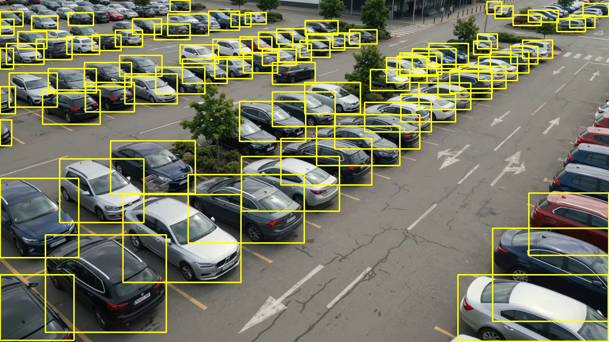
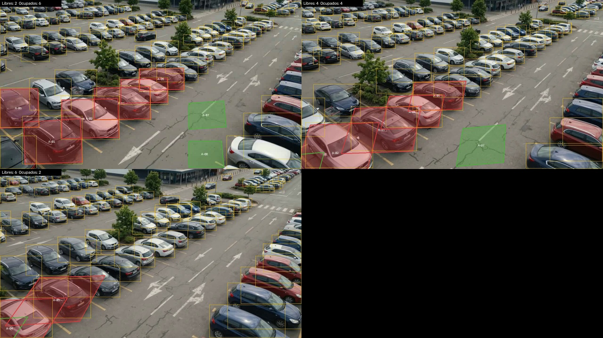
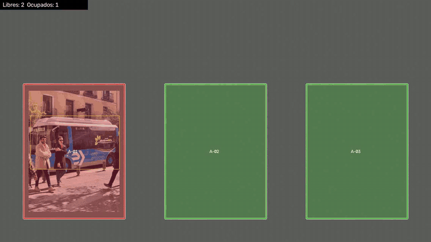

# Evidencias de pruebas y simulación

Resultados reales de las pruebas y de la simulación con video, generados el 20/10/2026 con la versión 1.0 del
sistema. Los textos son la salida tal cual de los programas (solo se reemplazaron rutas personales por `<repo>` y
`<usuario>`). Contexto y límites en [`docs/SIMULACION.md`](../docs/SIMULACION.md) y
[`docs/PRUEBAS_INTEGRACION.md`](../docs/PRUEBAS_INTEGRACION.md).

> **Importante:** no hay acceso a las cámaras del IEST. Todo lo de aquí se hizo con video simulado o generado con IA.
> Demuestra que el sistema funciona de punta a punta y cómo reacciona a distintas condiciones, pero **no** es una
> medición de precisión con las cámaras reales; eso queda para el piloto real.

## Vista rápida

**Cajones sobre el video generado con IA** (verde = libre, rojo = ocupado, amarillo = vehículo detectado). El video
completo está en [`video_resultado_cajones_estabilizados.mp4`](03_video_ia/video_resultado_cajones_estabilizados.mp4).


**Detección de vehículos en el primer fotograma** (72 a 86 vehículos por fotograma):



**Las mismas escenas bajo condiciones simuladas** (noche, lluvia, niebla, sol de frente y ruido):


**Cajones siguiendo el movimiento de la cámara** a los 0, 4 y 8 s (a los 8 s la toma ya cambió demasiado):



**Montaje sintético con verdad exacta** (3 cajones; un vehículo entra y sale):



## Índice

| Carpeta | Qué demuestra |
|---|---|
| [`01_pruebas_automaticas/`](01_pruebas_automaticas) | 55 pruebas automáticas (22 API y base de datos, 14 visión, 19 end-to-end) y verificación de tipos de la app, todas en verde; entorno de ejecución |
| [`02_simulacion_sintetica/`](02_simulacion_sintetica) | Montaje de 30 s con verdad exacta: métricas por condición (día, noche, lluvia, niebla, sol, ruido) |
| [`03_video_ia/`](03_video_ia) | Video de 10 s generado con IA (toma aérea de ~80 autos): detección, ocupación por cajón y condiciones adversas |
| [`05_panel/`](05_panel) | Capturas del panel con datos reales del modelo: resumen y mapa de islas con cobertura (ver [`docs/EJECUCION.md`](../docs/EJECUCION.md)) |
| [`04_cadena_completa/`](04_cadena_completa) | Cámara RTSP simulada → servidor de visión con YOLO → API → estado de los cajones, con entradas y salidas registradas |

## Resultados principales

**Pruebas automáticas** (`01_pruebas_automaticas/resultado_pruebas.txt`): 22 + 14 + 19 aprobadas, 0 fallas;
`tsc --noEmit` sin errores. Las end-to-end incluyen API real, cámara RTSP simulada con caída y reconexión, el modelo
YOLO real y el contrato de datos entre la app y la API.

**Montaje sintético** (`02_simulacion_sintetica/resultados.txt`), 90 comparaciones por versión:

| Versión | Exactitud | Precisión | Recall |
|---|---|---|---|
| Original | 0.944 | 0.927 | 0.950 |
| Noche | 0.856 | 0.886 | 0.775 |
| Lluvia, niebla, sol, ruido | 0.933 | 0.905 | 0.950 |

**Video generado con IA** (`03_video_ia/`):

| Medición | Resultado |
|---|---|
| Vehículos detectados por fotograma | 72 a 86 (YOLOv8n, imgsz 1280) |
| Ocupación, primeros 2.5 s, cajones fijos (8 cajones, 48 comparaciones) | Exactitud 1.000, 0 eventos falsos |
| Ocupación, 5 s con estabilizador | Exactitud 0.875 |
| Ocupación, 10 s con estabilizador | Exactitud 0.706 (la toma cambia demasiado; no es un fallo del detector) |
| Retención de vehículos: lluvia / sol / ruido / noche / niebla | 93.8 % / 84.3 % / 67.8 % / 63.8 % / 54.7 % |

**Cadena completa** (`04_cadena_completa/log.txt`): la API reflejó 5 entradas y 5 salidas coherentes con el guion del
video, y la cámara aparece en línea.

## Lo que estas evidencias no prueban

- Precisión con las cámaras del IEST, su ángulo, iluminación real o red.
- Reconocimiento de colgantes: no hay modelo entrenado; los vehículos quedan como "sin colgante identificado".
- La ocupación del video con IA se midió con una verdad etiquetada a ojo en 8 cajones (6 con auto, 2 de asfalto vacío
  como control); es una muestra pequeña. La "retención" se compara contra lo que el propio modelo ve en la imagen
  limpia, no contra etiquetas.
- App en un teléfono real y PostgreSQL: no probados (SQLite y verificación de tipos).

## Cómo se generaron

Requisitos: `ffmpeg`, `mediamtx` (en `herramientas_externas/mediamtx/`) y `vision/models/yolov8n.pt`.

```bash
python scripts/run_tests.py                                   # 01
python scripts/crear_video_prueba.py --imagen <foto> --salida datasets/prueba_sintetica   # 02 (montaje)
cd vision
python -m parking_vision.tools.procesar_video --config ../evidencias/03_video_ia/cameras.json \
    --camera CAM-01 --video ../evidencias/03_video_ia/video_original.mp4 \
    --etiquetas ../evidencias/03_video_ia/etiquetas.csv --cada 0.5 --estabilizar        # 03
python -m parking_vision.tools.comparar_condiciones --video ../evidencias/03_video_ia/video_original.mp4 --cada 1 --imgsz 1280
```

(Para repetirlo con el video de la carpeta `03_video_ia`, ajusta `source` en su `cameras.json` a la ruta del video.)

## Archivos

- `video_original.mp4`: el video generado con IA que se usó como entrada (7 MB).
- `video_resultado_*.mp4`: los mismos videos con los cajones dibujados (verde = libre, rojo = ocupado) y los
  vehículos detectados en amarillo.
- `detecciones_fotograma_*.jpg`, `montaje_*.jpg`: capturas de las detecciones, de los cajones siguiendo la cámara y
  de las condiciones simuladas.
- `cameras.json` y `etiquetas.csv`: los cajones dibujados y la verdad usada para medir, para poder repetir la medición.
- `linea_de_tiempo_por_cajon.csv`: estado de cada cajón en cada fotograma procesado.
